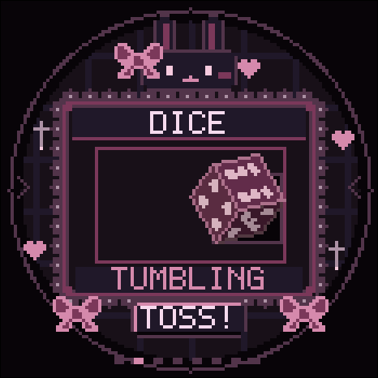
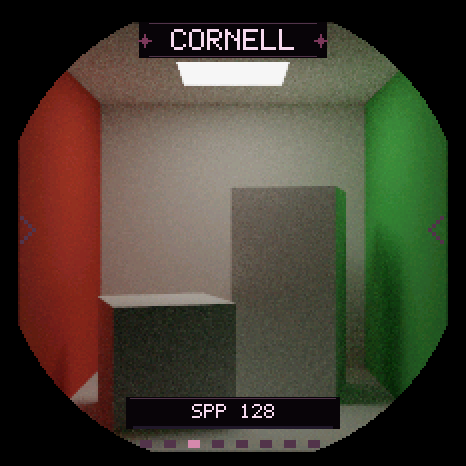
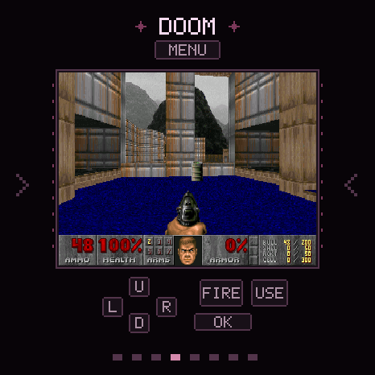
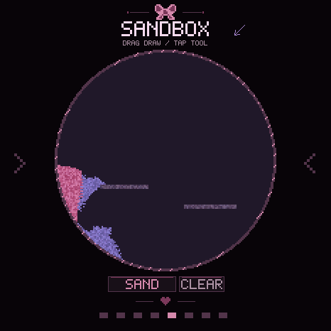
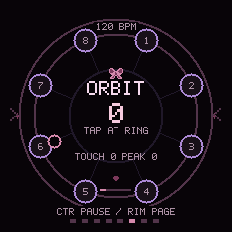
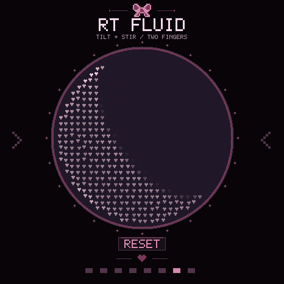
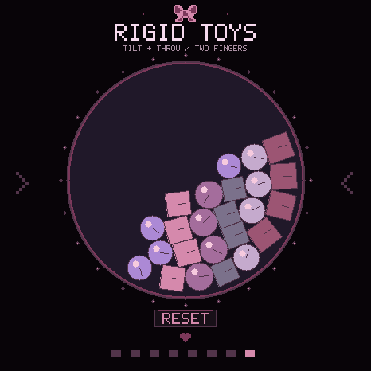

<div align="center">
୨♡୧ ┈┈┈ † ┈┈┈ ♡ ┈┈┈ † ┈┈┈ ୨♡୧
</div>

# BadgeESP32S3
Interactive toy demos for the **Waveshare ESP32-S3-Touch-AMOLED-1.75** , with a simple pixel UI.🥺

Template from https://github.com/kassane/zig-esp-idf-sample

### Demos

| ♡ Fumo | ⋈ DICE |
| :---: | :---: |
| <br />Textured 3D model, touch rotation, bounce and tilt parallax. | <br />Physical 3D dice with touch and IMU input. |
| **† Cornell** | **♥ Doom** |
| <br />Progressive software path tracing. | <br />Touch controls and a 320 × 200 software renderer. |
| **♡ Sandbox** | **⋈ Orbit Beat** |
| <br />Gravity-driven sand and water. | <br />Multi-touch rhythm game. |
| **† RT Fluid** | **♥ Rigid Toys** |
| <br />Real-time fluid simulation. | <br />2D rigid bodies, multi-touch grabbing and throwing. |

Edge swipe switches demos and PWR toggles standby.

### Build

Pinned: **Zig 0.17.0-xtensa · ESP-IDF 5.5.2 · LVGL 9.4.0**.
Install Git, Python 3.12 and CMake, then:

```sh
./scripts/bootstrap-idf.sh
./scripts/idf.sh build
./scripts/idf.sh -p YOUR_SERIAL_PORT flash monitor
```

```sh
./scripts/zig.sh build test -Doptimize=ReleaseSafe
./scripts/zig.sh build preview -Dpreview-demo=dice -Dpreview-roll-ms=5000 > .local/dice.ppm
```

---

[NOTICE](NOTICE) lists sources and licenses. Doom is GPL-2.0-or-later;
game data has separate terms. 

<div align="center">

୨♡୧ ┈┈┈ † ┈┈┈ ♥ ┈┈┈ † ┈┈┈ ୨♡୧

</div>
